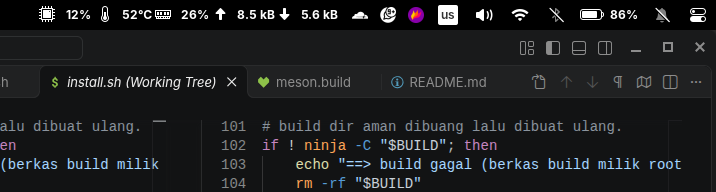

# Wingpanel Indicator Baki



A StatusNotifierItem (SNI / AppIndicator) host for **Wingpanel 8** on
elementary OS 8. Written in Vala with GTK3.

The name is Indonesian: *baki* means "tray" — the very thing this plugin puts
back in the panel.

## Why a Wingpanel plugin and not a regular AppIndicator app

Wingpanel 8 has no SNI/AppIndicator renderer, and the bundled
`xapp-sn-watcher` doesn't run on elementary OS 8. So AppIndicator apps never
turn up in the panel, whatever you install. An earlier version of this repo
was a standalone AppIndicator app, and it never drew a thing.

This plugin covers both halves of the job instead:

1. **SNI watcher**: it owns the `org.kde.StatusNotifierWatcher` bus name and
   answers `RegisterStatusNotifierItem` / `RegisterStatusNotifierHost`.
2. **SNI host**: it reads each item's properties
   (`org.kde.StatusNotifierItem`) and its menu (`com.canonical.dbusmenu`),
   then draws one panel icon per item plus a popover holding the menu.

Same arrangement Ubuntu uses with libayatana-appindicator3, except the
renderer lives inside Wingpanel.

## Build

You need `valac`, `meson`, `ninja`, `libgtk-3-dev`, `libgranite-dev`, and
`libwingpanel-3.0-dev` (or just the vapi/header files from
`libwingpanel-dev`).

The repo carries its own copies of `vapi/wingpanel.h` and
`vapi/wingpanel-8.0.vapi`, taken from Wingpanel 8.0.4, so you can build
without the `-dev` package installed.

```sh
meson setup build --prefix=/usr
ninja -C build
```

Everything lands in `build/`. Nothing outside that directory is touched. The
package name is `wingpanel-indicator-baki`, but the module installed is
still `libbaki.so`: Wingpanel only looks for the short name.

## Trying it without installing

```sh
./build/baki-harness build/libbaki.so
```

The harness loads the plugin the way Wingpanel does, prints the indicators
that got registered along with the contents of each item's menu, and clicks
the `Uji Klik` menu item if one exists. SNI apps running in your session show
up right away.

Check the icon conversion on its own (no display, no D-Bus):

```sh
meson test -C build                 # -> icon-data
```

`tests/fake_item.py` registers throwaway SNI items (bare `IconPixmap`, no
`IconName`) so the item-exit path can be exercised without real apps:

```sh
dbus-run-session -- sh -c 'GDK_BACKEND=x11 ./build/baki-harness build/libbaki.so &
  sleep 3; python3 tests/fake_item.py /Item/A /Item/B & sleep 5; kill %2; sleep 5; kill %1'
```

`--theme-dir=DIR` copies the Discord/Chromium style instead: it writes a raw
`status_icon_1.png` into `DIR` and advertises it through `IconName` +
`IconThemePath`, with no pixmap. Such icons only resolve via
`Gtk.IconTheme.lookup_icon()`, not `has_icon()`:

```sh
dbus-run-session -- sh -c 'GDK_BACKEND=x11 stdbuf -oL ./build/baki-harness build/libbaki.so &
  sleep 3; rm -rf /tmp/dtheme; python3 tests/fake_item.py --theme-dir=/tmp/dtheme /Discord &
  sleep 6; kill %2; wait %1'
```

## Layout

| File | What's in it |
| --- | --- |
| `src/PluginEntry.vala` | the `get_indicator()` symbol Wingpanel looks for |
| `src/Plugin.vala` | maps SNI items to Wingpanel indicators, cleans them up on exit |
| `src/Watcher.vala` | `org.kde.StatusNotifierWatcher` |
| `src/ItemIndicator.vala` | panel icon plus SNI properties (IconName, Status, XAyatanaLabel, Menu) |
| `src/DbusMenu.vala` | minimal `com.canonical.dbusmenu` client that builds GTK widgets |
| `src/IconData.vala` | `IconPixmap`/`AttentionIconPixmap` (raw ARGB) to `Gdk.Pixbuf`, plus scaling |
| `main.vala` | the old AppIndicator entry point, unused, kept as a note |

## Install

```sh
./install.sh                        # dependency, build, install, restart Wingpanel
```

Build dependencies are installed automatically with `apt-get` when missing
(`meson`, `ninja-build`, `valac`, `pkg-config`, `libglib2.0-dev`,
`libgee-0.8-dev`, `libgtk-3-dev`, `libgranite-dev`). `libwingpanel` needs no
`-dev` package: the repo carries the headers/vapi itself.

Or by hand, into `/usr/lib/x86_64-linux-gnu/wingpanel/`:

```sh
meson setup build --prefix=/usr
ninja -C build
sudo ninja -C build install
pkill io.elementary.wingpanel      # reload the panel
```

This writes to `/usr` (sudo needed), so do it only on the machine you want it
on. Nothing else is needed; `xapp-sn-watcher` can stay off.

Dry run without touching `/usr` (Meson's `DESTDIR` convention):

```sh
DESTDIR=/tmp/st ./install.sh        # files land in /tmp/st/usr/...
DESTDIR=/tmp/st ./uninstall.sh
```

## Uninstall

```sh
./uninstall.sh                      # remove the plugin + restart Wingpanel
```

The install adds exactly one file and no autostart entries, D-Bus services or
config, so removing that file is a full revert: the session goes back to stock
Wingpanel 8, where nothing owns `org.kde.StatusNotifierWatcher`.

## License

GPL-3.0-or-later — see [`LICENSE.md`](LICENSE.md), the full text of GPLv3. The
`vapi/wingpanel.h` and `vapi/wingpanel-8.0.vapi` copies are generated from
Wingpanel 8.0.4 and stay under Wingpanel's own GPL-3.0-or-later terms.

## Known limits

- Icons come from `IconPixmap`/`AttentionIconPixmap` first (which many apps use
  on their own), then `IconName` (theme name or absolute/`file://` path), then
  `IconThemePath`.
- Left-clicking the icon opens the popover. SNI `Activate` and
  `SecondaryActivate` are never called, because Wingpanel owns the popover
  gesture.
- The tray's position is set by Wingpanel's `IndicatorSorter` (hardcoded
  `code_name` order), so icons can only move as one block. This plugin uses
  `monitor-ayatana-<bus><path>` to sit right after Monitor and before
  nightlight; rename that prefix in `src/ItemIndicator.vala` to move the block
  (`tests/order_test.vala` pins the choice).
- The popover is built out of `Gtk.Box` instead of `Gtk.Menu`, since
  Wingpanel's popover is a plain container; submenus use `Gtk.MenuButton`.
- Items whose app quits are **hidden**, never deregistered: Wingpanel 8.0.4
  aborts (`IndicatorBar.remove_indicator` removes from a `Gee.List` while
  iterating it, tripping the `arraylist.c` assert `index < _size`) and takes the
  whole panel down. Items whose properties cannot be read (dead object path,
  apps behind `xdg-dbus-proxy`) are hidden the same way instead of showing an
  empty slot; a later SNI signal brings them back if they turn out alive.
  `IndicatorManager` never drops such entries, so a long session with heavy tray
  churn keeps a few hidden ones around — log out or `pkill
  io.elementary.wingpanel` to clear them.
